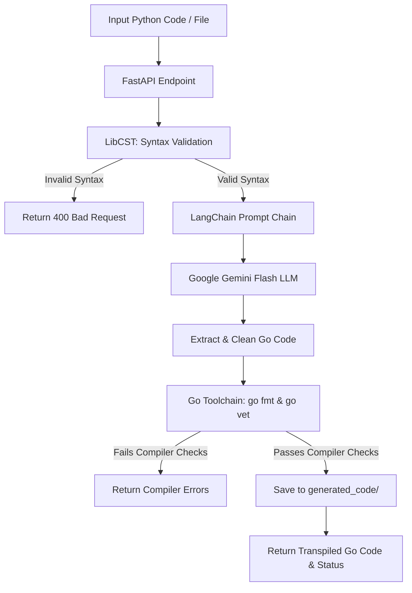

# Polyglot Refactor Engine ⚡

An AI-powered neural source-to-source code transpiler and modernization API that converts Python code into idiomatic Go. 

Built using a **Compound Generative AI System architecture**, this project combines foundation models (**Google Gemini** via **LangChain**) with deterministic compiler guardrails (**LibCST**, **`go fmt`**, and **`go vet`**) to ensure generated code is not only idiomatic but also syntactically correct and compilable.

---

## 🌟 Key Features

* **LLM-Driven Transpilation:** Leverages Google Gemini (`gemini-3.6-flash`) with prompt engineering tailored for idiomatic Go conventions, proper pointer semantics, explicit error handling (`if err != nil`), and type definitions.
* **Input Syntax Verification:** Validates input Python source code before invoking the LLM using Concrete Syntax Trees (`libcst`).
* **Compiler-in-the-Loop Validation:** Automatically validates generated Go code against real Go toolchains (`go fmt` and `go vet`).
* **Dual Ingestion Endpoints:**
  * **Raw Code Transpilation:** Direct JSON payloads for code snippets.
  * **File Upload Transpilation:** Multipart `.py` file uploads with deterministic `.go` file persistence in `generated_code/`.
* **Extensible Architecture:** Pre-structured directories for Retrieval-Augmented Generation (RAG) and Tree-sitter AST parsing.

---

## 🏗️ Architecture & Workflow



---

## 📂 Project Structure

```text
code-transpiler-ai/
├── app/
│   ├── config.py              # Environment configuration & API keys
│   ├── main.py                # FastAPI endpoints & application routing
│   ├── parsers/               # Code parsing utilities (Tree-sitter / AST)
│   ├── rag/                   # Retrieval-Augmented Generation modules
│   ├── services/
│   │   ├── file_writer.py     # Deterministic disk persistence for generated files
│   │   └── transpiler.py      # Core LLM prompt chain & transpilation pipeline
│   └── validators/
│       └── go_validator.py    # Compiler guardrails running `go fmt` & `go vet`
├── generated_code/            # Output folder for verified transpiled .go files
├── requirements.txt           # Python dependencies
├── .env.development           # Local environment configuration
└── README.md
```

---

## 📋 Prerequisites

Before running the service, make sure you have:

1. **Python 3.10+**
2. **Go (1.18+)**: The Go compiler must be installed and accessible in your system `PATH` (used by `go fmt` and `go vet`).
   ```bash
   go version
   ```
3. **Google Gemini API Key**: Obtain an API key from [Google AI Studio](https://aistudio.google.com/).

---

## 🚀 Getting Started

### 1. Clone the Repository

```bash
git clone https://github.com/GautamViki/code-transpiler-ai.git
cd code-transpiler-ai
```

### 2. Set Up Virtual Environment

```bash
python3 -m venv .venv
source .venv/bin/activate   # On Windows: .venv\Scripts\activate
```

### 3. Install Dependencies

```bash
pip install -r requirements.txt
```

### 4. Configure Environment Variables

Add your Google Gemini API key inside `.env.development`:

```env
GOOGLE_API_KEY=your_gemini_api_key_here
ENVIRONMENT=development
```
*(Note: `app/config.py` automatically loads `.env.development` by default when `ENVIRONMENT=development`).*

### 5. Start the Server

Run the development server using `uvicorn`:

```bash
uvicorn app.main:app --reload --host 0.0.0.0 --port 8000
```

Once running, interactive API docs are available at:
* **Swagger UI:** [http://localhost:8000/docs](http://localhost:8000/docs)
* **ReDoc:** [http://localhost:8000/redoc](http://localhost:8000/redoc)

---

## 📡 API Reference

### Health Check
`GET /`

Returns the service status.

```bash
curl -X GET http://localhost:8000/
```

**Response:**
```json
{
  "status": "running",
  "service": "Polyglot Refactor Engine"
}
```

---

### Transpile Code Snippet
`POST /api/v1/transpile`

Transpiles a raw Python string into Go.

**Request Body:**
```json
{
  "source_code": "def add(a: int, b: int) -> int:\n    return a + b",
  "source_language": "python",
  "target_language": "go"
}
```

**Example Request:**
```bash
curl -X POST http://localhost:8000/api/v1/transpile \
  -H "Content-Type: application/json" \
  -d '{
    "source_code": "def add(a: int, b: int) -> int:\n    return a + b",
    "source_language": "python",
    "target_language": "go"
  }'
```

**Response:**
```json
{
  "success": true,
  "filename": "transpiled_2026Aug13_01h_27m_04s.go",
  "saved_path": "generated_code/transpiled_2026Aug13_01h_27m_04s.go",
  "validation_message": "Code passed Go compiler syntax checks."
}
```

---

### Transpile File Upload
`POST /api/v1/transpile-file`

Uploads a `.py` file, transpiles it to Go, runs compiler validations, and persists the generated file under `generated_code/<filename>.go`.

**Example Request:**
```bash
curl -X POST http://localhost:8000/api/v1/transpile-file \
  -F "file=@path/to/script.py"
```

**Response:**
```json
{
  "success": true,
  "filename": "script.go",
  "saved_path": "generated_code/script.go",
  "validation_message": "Code passed Go compiler syntax checks."
}
```

---

## 🔮 Roadmap

- [ ] **RAG-Assisted Idiomatic Idioms:** Index Go standard library packages and design patterns with ChromaDB to guide code generation.
- [ ] **Multi-File / Module Transpilation:** Support packaging whole Python modules into Go packages with `go.mod` creation.
- [ ] **Additional Language Pairs:** Expand support for Go-to-Python and Python-to-Rust transpilation.
- [ ] **Automated Unit Test Generation:** Generate corresponding `_test.go` suites along with the transpiled implementation.

