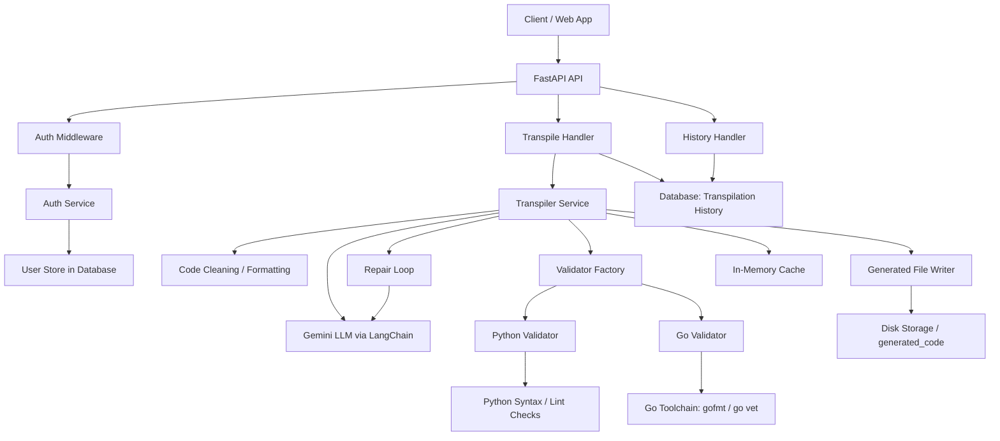
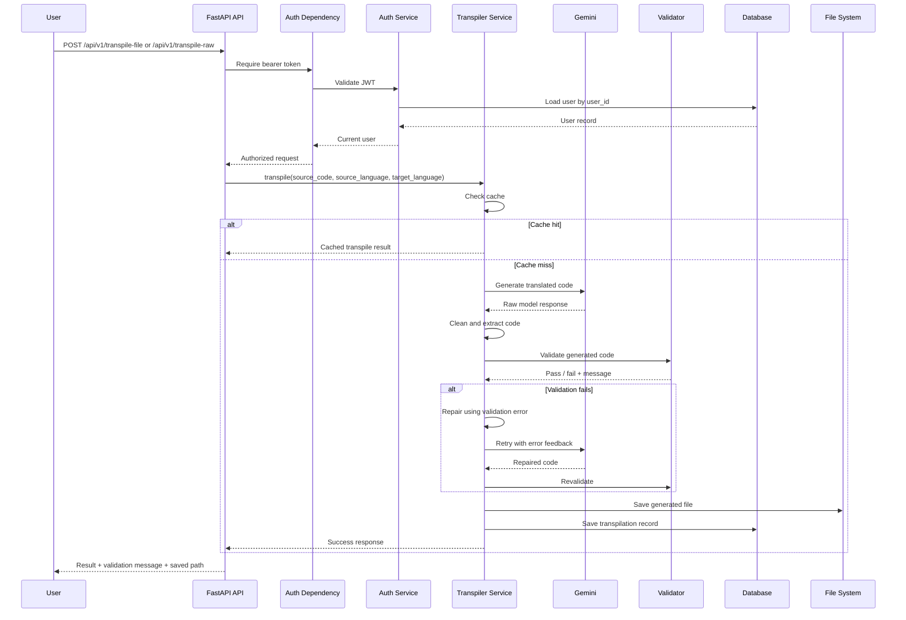

# High-Level Design: CodeShift Backend

## 1. Overview

CodeShift Backend is an API-first service that helps authenticated users convert source code from one language to another using an AI model and validation guardrails. The service accepts either raw source text or uploaded files, sends the code to Google Gemini via LangChain, validates the generated output, optionally repairs it, saves the result, and persists histories for each user.

The project is designed around three primary concerns:

1. User access and security
2. Code transpilation with AI
3. Validation, repair, persistence, and reuse

---

## 2. Goals

- Allow users to transpile code from supported source languages to supported target languages
- Support both raw code requests and file uploads
- Protect endpoints with JWT-based authentication
- Use LLM-generated code while enforcing compiler-level correctness checks
- Persist transpilation history per user
- Cache repeated requests to minimize unnecessary model calls
- Keep the service extensible for more languages and validators in the future

## 3. Non-goals

- Building a frontend application
- Supporting public unauthenticated transpilation
- Full multi-file repo transpilation with project-aware dependency analysis
- A complete autonomous code agent with long-running planning loops

---

## 4. High-Level Architecture

The application is a layered backend with the following major components:

- API layer: FastAPI routes and request handling
- Auth layer: JWT creation/verification and password hashing
- Transpilation service: LLM orchestration and prompt handling
- Validation layer: language-specific syntax and compile checks
- Persistence layer: SQLAlchemy async database and model storage
- Cache layer: in-memory transpile cache keyed by source-language-target-language-content hash
- External integration: Google Gemini API and Go toolchain

---

## 5. Runtime Components

### 5.1 API Layer

The app entry point is created in `app/main.py` and includes the main router from `app/api/url_def.py`.

Responsibilities:
- Expose HTTP routes
- Configure cross-origin access
- Attach global exception handling
- Log request activity
- Wire request lifecycle for dependencies

Routes include:
- `/api/v1/auth/register`
- `/api/v1/auth/login`
- `/api/v1/transpile-file`
- `/api/v1/transpile-raw`
- `/api/v1/history`

### 5.2 Auth Layer

Auth logic is implemented in:
- `app/services/auth.py`
- `app/dependencies.py`
- `app/handlers/auth_handler.py`

Responsibilities:
- validate email/password
- hash passwords using bcrypt
- create JWT access tokens
- verify incoming bearer tokens for protected routes
- fetch the current user from the database

### 5.3 Transpilation Layer

The transpile engine is implemented in `app/services/transpiler.py`.

Responsibilities:
- build the prompt for the AI model
- invoke Gemini through LangChain
- clean the raw LLM output
- trim markdown fences and surrounding text
- validate generated code
- repair failing code using validation feedback
- save generated files
- cache repeated results

### 5.4 Validation Layer

Validator implementation is in `app/validators/code_validator.py`.

Current validation support includes:
- Python validator
- Go validator

Responsibilities:
- run syntax/lint/compile checks
- ensure generated code is valid enough to use
- clean import issues when possible
- return validation result + corrected code

### 5.5 Data / Persistence Layer

Data models are in `app/models` and database wiring is in `app/database.py`.

Key models:
- `User`: stores user login data and timestamp
- `Transpilation`: stores source code, generated code, language pair, validation status, timestamps

The database allows:
- user registration and login
- retrieving user history
- deduplicating or tracking repeated transpilation requests

### 5.6 Cache Layer

The app uses an in-memory transpile cache and a deterministic hash generated from:
- source language
- target language
- source code content

This avoids re-running expensive LLM calls when the exact same transformation is requested again.

---

## 6. End-to-End Request Flow

### 6.1 Authenticated transpile request

### 6.2 File upload path

The file upload request goes through the same process but first:
- reads the uploaded bytes
- decodes UTF-8 text
- infers the source language from the file extension
- validates language support and target language support
- proceeds to transpile as normal

### 6.3 Raw text path

The raw text flow gets:
- source language and target language as query parameters
- the code body as plain text
- validation and cache flags
- the same transpile engine pipeline as the file workflow

---

## 7. Data Model Design

### User

Represents an authenticated account.

Fields:
- id
- email
- hashed_password
- phone_number (optional)
- created_at

### Transpilation

Represents a single transpilation event tied to a user.

Fields:
- id
- user_id
- source_language
- target_language
- source_code
- transpiled_code
- source_hash
- validated
- validation_message
- created_at

The model includes a unique constraint that prevents duplicate transpilation records for the same user for the same source hash and target language.

---

## 8. Validation and Repair Strategy

The project uses a compiler-style feedback loop rather than a fully autonomous agentic loop.

Flow:
1. generate code
2. validate code
3. if validation fails, send the validator error back to the LLM
4. ask for a corrected version
5. validate again
6. stop after a bounded number of repair tries

This is a limited self-correction mechanism designed to improve reliability without endlessly retrying.

Important characteristics:
- validation is deterministic and tool-based
- repair uses AI feedback from the validator message
- the loop is bounded to prevent model waste and infinite retries

---

## 9. Security Considerations

The project includes several baseline protections:

- password hashing with bcrypt
- JWT verification for protected endpoints
- database access through async session-managed dependencies
- environment-based secret loading
- AWS Secrets Manager fallback in config for external API credentials

This is suitable for a backend service but should still be hardened for production with:
- stronger secret management policies
- rate limiting
- stricter CORS policy per environment
- encrypted database and secret storage
- production-grade logging and monitoring

---

## 10. External Dependencies

### Gemini / LangChain

The LLM is used to generate code in the target language. The configuration includes:
- model name: `gemini-3.6-flash`
- low temperature for deterministic outputs
- result extraction and cleanup logic

### Go toolchain

For Go validation, the system can invoke:
- `gofmt`
- `go vet`
- optionally `goimports`

### Database

The backend relies on SQLAlchemy async database access, with a `DB_URL` environment variable required to connect.

---

## 11. Current Design Strengths

- Clear separation of API, business logic, validation, and persistence
- Good use of dependency injection for auth and database access
- Retry loop with validation feedback for better generated-code quality
- Hash-based cache reduces repeated model usage
- User-centric transpilation history for accountability and reuse

## 12. Current Limitations

- Backend only; no UI layer
- Validation coverage is strongest for Python and Go
- Not a full repository-aware transpiler
- No large-scale RAG or AST-analysis pipeline yet
- LLM output is still dependent on prompt quality and model behavior

---

## 13. Summary

CodeShift Backend is an AI-powered transpilation service built on FastAPI. It combines an LLM (Gemini), language-specific validators, and a bounded repair loop to produce code that is more likely to be valid and usable. The overall system is designed for authenticated, reusable, history-aware code transformation rather than ad hoc code generation.

In short:

Client -> API -> Auth -> Transpile -> Validate -> Repair -> Save -> History

This is a practical architecture for trustworthy AI-assisted code translation with guardrails.
